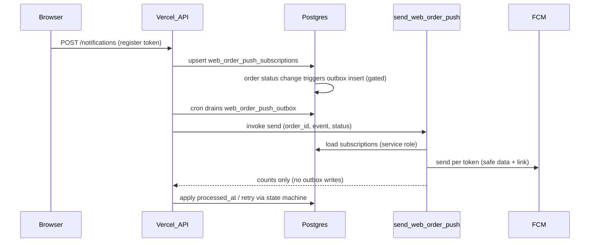

# Web Order Push — Phase 2 Implementation Notes

Date: 2026-07-21 (updated 2026-07-21 — Phase 2B readiness fixes)

## Phase 1 smoke gate

Production flag-off verified: `GET /api/public/orders/track/{token}` returns `404 {"success":false,"error":"unavailable"}` when `WEB_ORDER_TRACKING_ENABLED=false`.

Full owner smoke (real order + redirect + refresh) remains required before customer rollout of tracking/push flags.

## Phase 2A vs 2B status

| Gate | Status | Notes |
|------|--------|-------|
| Phase 2A (registration + manual test send) | **Ready for owner proof** | Firebase web + VAPID live; open tracking page → enable notifications → internal test-send → click opens tracking URL |
| Phase 2B (automatic outbox on order status) | **ENABLED (2026-07-22)** | Tables applied; `WEB_ORDER_PUSH_ENABLED=true` on Vercel + Supabase; trigger gated on active subscription |

### Phase 2B enablement (2026-07-22)

1. Applied missing migrations: `web_order_push_subscriptions`, `web_order_push_outbox` (+ subscription-gated enqueue trigger).
2. Set `WEB_ORDER_TRACKING_ENABLED=true` and `WEB_ORDER_PUSH_ENABLED=true` on Vercel Production.
3. Set Supabase secret `WEB_ORDER_PUSH_ENABLED=true` (hash verified).
4. Redeployed production (`www.sahla-delivery.com`).
5. **Still required for customer registration:** Firebase Web app + VAPID (`NEXT_PUBLIC_FIREBASE_*`) on Vercel, then rebuild so SW gets real config.
6. Fixed `vercel.json` so `/api/internal/web-order-push/*` routes to Next.js (was swallowed by Express).
7. **2026-07-22:** Firebase web config + VAPID set on Vercel Production; SW regenerated with real config. Ready for Phase 2A register → test-send → click proof.

## Owner review fixes (2026-07-21)

### P1 — fixed

1. **Outbox rows with no subscriptions retry forever** — trigger `web_order_push_outbox_subscription_gate` only inserts when an active `web_order_push_subscriptions` row exists for the order + valid tracking link. Migration: `20260723120000_web_order_push_outbox_subscription_gate.sql`.
2. **Edge Function marked `processed_at` on failures** — removed outbox mutation from `send-web-order-push`; Vercel drainer owns all `processed_at` / retry state via `webOrderPushOutboxState.js`.
3. **FCM payload included raw `order_id`** — `buildSafeWebPushData()` sends only `{ type, event, status }`; click routing via `webpush.fcm_options.link`.
4. **SW notification click focused first window** — `firebase-messaging-sw.template.js` matches URL → focus; same-origin navigate → focus; else `openWindow`.

### P2 — fixed

5. **Global sessionStorage registration key** — scoped to `sahla_web_push_reg:{tokenPrefix}` per tracking token.
6. **Missing PushManager detection** — `browserSupport.ts` returns `no_push` when `PushManager` absent.
7. **Test coverage** — added/updated tests for click routing, outbox state machine, FCM safe data, browser support, firebaseWeb registration scope.

## Architecture

## FID vs legacy token (spike conclusion)

- **Client:** `getToken()` via Firebase Web Messaging → stored as `registration_kind: legacy_token`
- **Sender:** FCM HTTP v1 `messages:send` uses `message.token` with `webpush.fcm_options.link`
- **Reason:** Existing Sahla mobile sender already targets registration tokens; FID-native send path not verified against FCM v1.

## Service worker config

**Strategy A (build-time generation):** `web/scripts/generate-firebase-messaging-sw.mjs` runs in `prebuild`, writing `public/firebase-messaging-sw.js` from `NEXT_PUBLIC_FIREBASE_*`.

## Tracking URL sensitivity

- `click_url` stored service-role-only on `web_order_push_subscriptions` at registration
- Edge function logs order_id, event, send counts only — never `click_url`, registration values, or FCM bodies
- FCM browser `data` payload: `{ type, event, status }` only

## Rollout

1. Apply migrations (in order):
   - `20260722120000_web_order_push_subscriptions.sql`
   - `20260722130000_web_order_push_outbox.sql`
   - `20260723120000_web_order_push_outbox_subscription_gate.sql`
2. Deploy `send-web-order-push` Edge Function; keep `WEB_ORDER_PUSH_ENABLED=false` in Supabase secrets
3. Deploy web with `WEB_ORDER_PUSH_ENABLED=false`
4. Set Firebase `NEXT_PUBLIC_*` env on Vercel
5. **Phase 2A proof:** register on tracking page → internal test send → notification click opens correct tracking URL
6. Only after 2A proof: set `WEB_ORDER_PUSH_ENABLED=true` on Vercel + Supabase

## Rollback

- `WEB_ORDER_PUSH_ENABLED=false` — tracking polling unchanged; subscriptions/outbox retained
- `WEB_ORDER_TRACKING_ENABLED=false` — blocks tracking reads/issuance and push registration

## Test results (2026-07-21)

- Web vitest: **78/78 passed**
- Node outbox state: **6/6 passed**
- Next.js build: **passed**

## Stops preserved

No SMS/WhatsApp/email, no Realtime replacement, no extraction/search/replica/CDC/warehouse, no Flutter mobile changes, no new notification vendor.
